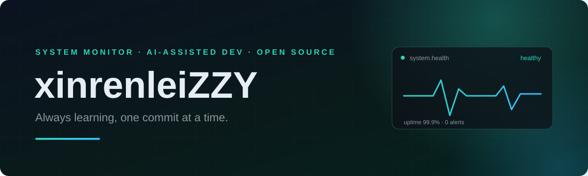

### Hi, I'm xinrenleiZZY 👋

> *"If you want to create something great, you have to be willing to question everything, including your own rules."*
>
> 若想创造卓越，你必须敢于质疑一切——包括你自己设定的规则。
>
> —— Paul Graham

> *"Simplicity is prerequisite for reliability."*
>
> 简洁是可靠性的前提。
>
> —— Edsger W. Dijkstra

⚡ **In the AI era, teaching my way toward becoming a full-stack engineer.** ⚡

I build small tools that make my own workflow better — currently a **Windows system health monitor** that pushes alerts to Feishu, plus a few automation scripts.

在 AI 时代，一边用 AI 解决真实问题，一边把过程还给开源社区。

  

#### 🧰 Tech stack

  

#### 🚀 Featured projects

<!-- 把下面两行换成你真实存在的仓库；没有仓库就删掉这一节，别留 404 链接。 -->

| Project | What it does | Stack |
| :-- | :-- | :-- |
| [system-health-monitor](https://github.com/xinrenleiZZY?tab=repositories) | Windows 系统健康监测，异常自动推送到飞书 | Python · PowerShell |
| [More repositories →](https://github.com/xinrenleiZZY?tab=repositories) | 其他实验性项目和小工具 | — |

#### 🔗 Find me

  
  <!-- 有博客/邮箱就取消注释并填上：
  
  
  -->

<i>Always learning, one commit at a time.</i>
